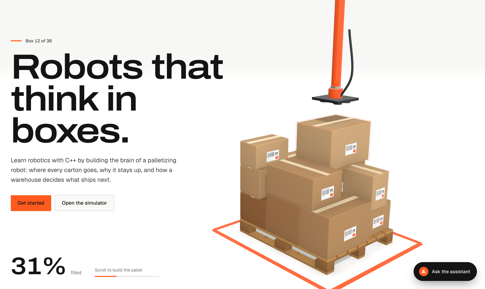
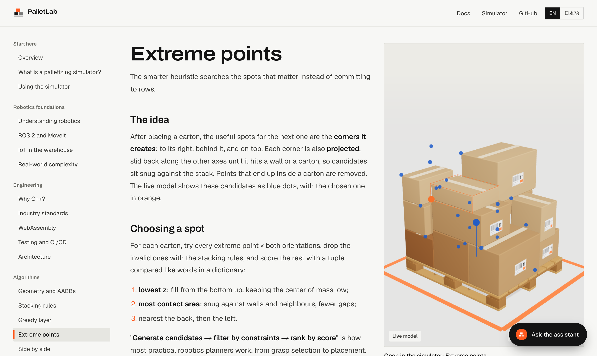
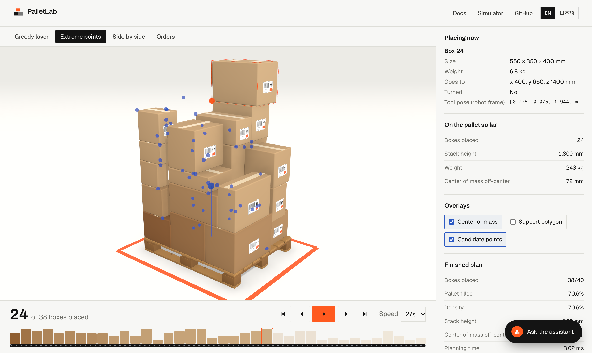

# PalletLab — Robotics with C++

A learning platform for **robotics with C++**, built around one industrial problem: a robot arm
stacking mixed cartons onto a pallet. A C++20 planning engine decides where every carton goes under
real stacking rules; the same engine runs as a **ROS 2 node** and, compiled to **WebAssembly**, live
in the browser. The site has a creative landing page, 19 documentation chapters in **English and
Japanese** (chosen from the visitor's browser language), each with a live 3D model, a simulator, and an
AI assistant that answers questions about the docs and the code.

Inspired by the work of industry leaders in Japanese warehouse robotics. An independent learning project.



| Docs dashboard | Simulator |
|---|---|
|  |  |

## What's inside

| Part | Stack |
|---|---|
| Planning engine (`core/`) | C++20, CMake + presets, vcpkg (fmt, nlohmann/json, Eigen, CLI11), GoogleTest (330 tests), Google Benchmark, ASan/UBSan |
| Robot integration (`ros2/`) | ROS 2 Jazzy: `/plan_pallet` service, MarkerArray, TF frames, launch file, gtest + launch_testing, Docker |
| Website (`web/`) | Next.js 16, TypeScript, Tailwind CSS 4, next-intl (en/ja), MDX, React Three Fiber + drei + postprocessing, GSAP ScrollTrigger, Lenis, Motion |
| Browser engine | Emscripten + embind, run in a Web Worker; byte-identical to the native CLI |
| AI assistant | AI SDK 7, BM25 retrieval over docs + source, Groq first with Gemini failover, BotID + rate limiting |
| Quality | Vitest, Playwright (English + Japanese browsers, desktop + phone, axe accessibility), GitHub Actions CI/CD to Vercel |

## Results

| 40 cartons, 50 seeds | Greedy layer | Extreme points |
|---|---|---|
| Cartons placed | 55% | **90%** |
| Pallet filled | 37% | **64%** |
| Center of mass off-centre | 193 mm | **73 mm** |
| Planning time | 0.05 ms | 3.2 ms |

| 24 orders over a shift | Order by order | Waves |
|---|---|---|
| Pallets used | 15 | **7** |
| Average fill | 19% | **42%** |
| Shift length | **17 min** | 25 min |

## Run it

```bash
# C++ engine (needs CMake, Ninja, vcpkg: export VCPKG_ROOT=~/vcpkg)
cd core && cmake --preset release && cmake --build --preset release && ctest --preset release

# ROS 2 package (needs Docker only)
scripts/ros.sh build && scripts/ros.sh test && scripts/ros.sh call

# Website
cd web && npm install
npm run engine        # C++ plans + WebAssembly into web/public (Emscripten for the WASM part)
cp ../.env.example ../.env.local   # add GROQ_API_KEY and GEMINI_API_KEY for the assistant
npm run dev           # http://localhost:3000
npm test && npm run build && npm run test:e2e
```

The design, the build log and notes on every concept are in [`idea/`](idea/).
