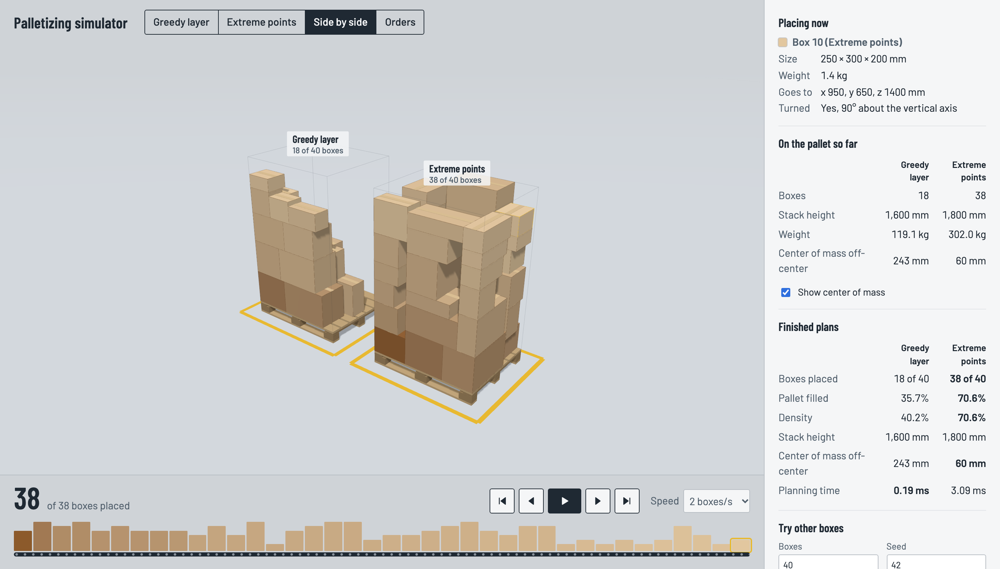
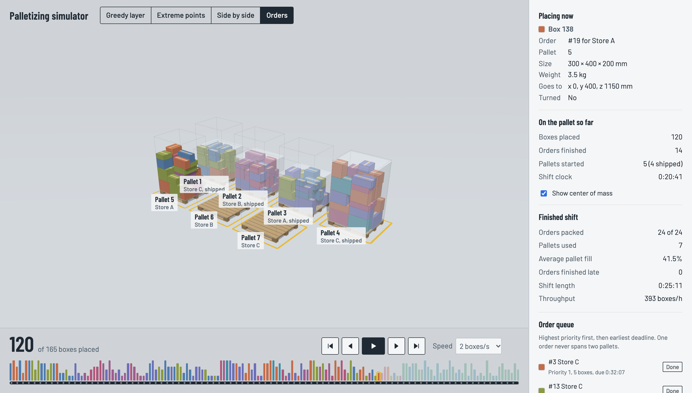

# Palletizing Simulator

A robot arm stacks mixed cartons onto a pallet. This project plans **where each carton goes**, with
a C++ engine that follows height, weight and stability rules, and shows the result in a three.js
viewer that replays the plan box by box. The same C++ also runs in the browser via WebAssembly.

**Live demo:** https://riteshs1.github.io/palletizing-simulator/



## What's inside
- **Stacking rules**: inside the pallet, no overlap, reachable from above by a top-down gripper,
  ≥75% of the base supported, center over the support polygon (convex hull), no heavy box on a
  lighter one, max load, upright only.
- **Two packers**: a greedy layer baseline (first-fit shelves) and an Extreme-Points heuristic with
  candidate scoring and multi-start.
- **WES layer**: customer orders for three destinations go through a priority queue and onto
  pallets, either order by order or in batched waves.
- **Viewer**: step-by-step playback with a vacuum gripper, a center-of-mass marker, a conveyor-style
  timeline, side-by-side comparison, a multi-pallet orders view, and live planning in the browser.

## Results
Extreme points vs greedy, 50 random seeds, 40 boxes each:

| | Greedy layer | Extreme points |
|---|---|---|
| Boxes placed | 55% | **90%** |
| Pallet filled | 37% | **64%** |
| Center of mass off-center | 193 mm | **73 mm** |
| Planning time | 0.05 ms | 3.3 ms |

The WES, 24 orders over a shift:

| | Order by order | Waves |
|---|---|---|
| Pallets used | 15 | **7** |
| Average pallet fill | 19% | **42%** |
| Shift length | **17 min** | 25 min |

Waves pack far better because the planner sees a whole pallet's worth of boxes at once, at the cost
of orders waiting.



## Run it
```bash
make -C core test        # 29 unit + property tests
make -C core bench       # compare the packers over 50 seeds

cd web && npm install
npm run dev              # builds the C++ data (and WASM if Emscripten is installed), opens :5173
npm run build && npm run test:e2e   # Playwright end-to-end tests
```

## How it's built
- `core/`: C++17, standard library only, plain Makefile. Integer millimetres, seeded randomness,
  deterministic everywhere.
- `web/`: three.js + Vite, no framework.
- CI/CD (GitHub Actions): C++ tests on Linux and macOS, then Playwright, then deploy to GitHub Pages.

The design, the step-by-step build log and notes on every concept are in [`idea/`](idea/).
